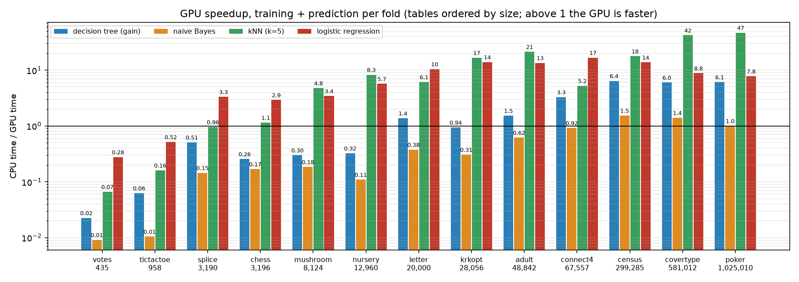

# ESE 327 Project 2 — Decision tree induction in C++ and CUDA

A decision tree classifier with three attribute selection measures (information gain,
gain ratio, Gini index), written from scratch in C++17, and three classifiers to compare it
with: naive Bayes, k-nearest neighbors, and logistic regression. Every classifier exists
twice, as a sequential CPU program and as a CUDA program, and the two give the same answers.

| classifier | CPU | CUDA | what the GPU does |
|---|---|---|---|
| decision tree | `dtree_cpu` | `dtree_gpu` | grows a whole level of the tree at once: histograms, split scoring, and partitioning |
| naive Bayes | `nbayes_cpu` | `nbayes_gpu` | counting, per-class mean and variance, prediction |
| k-nearest neighbors | `knn_cpu` | `knn_gpu` | exhaustive distance search and voting |
| logistic regression | `logreg_cpu` | `logreg_gpu` | loss and gradient of every L-BFGS step |

No machine learning library is used by the programs. scikit-learn appears only in the test
scripts, as an outside reference.

## Results at a glance

Measured on 13 UCI tables (435 to 1,025,010 records) with stratified 10-fold
cross-validation, on an Intel i5-12400F and an NVIDIA RTX 3060 Ti. Full tables are in
[`results/rtx3060ti/summary.md`](results/rtx3060ti/summary.md).


* A decision tree is the most accurate classifier, or tied for it, on 9 of the 13 tables.
* The selection measure matters on some tables and not on others. On the poker table,
  gain ratio reaches 61.8% where information gain reaches 51.8%; on the chess endgame
  table `krkopt`, the Gini index reaches 82.0% where the other two reach 72.8%.
* Pruning shrinks the tree by a factor of up to 10 (census: 102,415 nodes to 9,718) and
  raises accuracy on the noisy tables (adult 81.7% to 85.1%), but costs accuracy on
  tables with no noise (nursery 98.9% to 97.0%).



* The GPU is slower on small tables, where a few milliseconds of launch overhead dominate, and faster
  from about 20,000 records up.
* On the three largest tables the GPU tree trains about 6 times faster than the CPU tree
  (poker: 1,166 ms to 191 ms per fold) and builds exactly the same tree.
* kNN gains the most: 42 times on covertype and 47 times on poker. Logistic regression
  gains 8 to 17 times on tables of 20,000 records or more. Naive Bayes is a single pass
  over the data on either device, so the GPU about breaks even.

## Status

All eight programs are built and tested (2,306 checks pass, see [Validation](#validation))
and benchmarked on one machine. The written report is separate; this README records the
design and the measurements it will draw on. The CUDA build has been run on Windows only;
the Linux `make gpu` path is written but not yet tried.

## Repository layout

```
include/dataset.h, eval.h, runner.h   table loader, stratified splits, metrics, run report
include/dtree.h                       tree, binning, pruning (shared by CPU and GPU)
include/dtree_app.h, nbayes.h,        options, model and main() of each classifier;
        knn_app.h, logreg.h           the CPU and GPU sources only supply a backend
include/encode.h, lbfgs.h             one-hot encoding and L-BFGS for logistic regression
include/cuda_compat.h                 CUDA / CUB wrappers, and serial emulation without CUDA
src/<name>_cpu.cpp                    sequential implementation
src/<name>_gpu.cu                     CUDA implementation
src/<name>_gpu_emu.cpp                the .cu file compiled as plain C++ (kernels run serially)
data/examples/                        textbook examples with their published trees
scripts/fetch_uci.py                  downloads and converts the 13 UCI tables
scripts/dtree_ref.py                  independent decision tree in pure Python
scripts/run_tests.py                  runs the four test suites
scripts/benchmark.py                  benchmark sweep: CSV, Markdown tables, figures
results/<machine>/                    benchmark output
```

## Building

Requirements: a C++17 compiler; the CUDA Toolkit for the GPU programs; Python 3 with
numpy, pandas, scikit-learn and matplotlib for the scripts.

```bash
make                # CPU programs, emulation builds, tools; GPU programs if nvcc is usable
make gpu            # only the CUDA programs
python scripts/fetch_uci.py     # download and convert the benchmark tables into data/uci/
```

On Windows, use `mingw32-make` with MSYS2 g++ for the CPU programs. `nvcc` needs the MSVC
compiler, so the CUDA programs are built with a batch file that finds Visual Studio itself,
or with CMake from a developer prompt:

```bat
scripts\build_gpu.bat                 :: all four, or name them: scripts\build_gpu.bat dtree knn
cmake -B build -G Ninja -DCMAKE_BUILD_TYPE=Release && cmake --build build
```

Two build settings matter:

* The kernels are compiled for the GPU in the machine (`-arch=native`). With a driver
  older than the toolkit, a binary built for the default architecture stops at startup with
  "the provided PTX was compiled with an unsupported toolchain".
* `--fmad=false` stops the compiler from fusing multiply and add, so the kernels round
  the same way as the CPU code. The identical trees depend on it.

## Usage

Every program takes a table and the same evaluation options:

```
dtree_cpu  <table.csv> [--measure gain|gain_ratio|gini] [--prune] [--prune-cf CF]
                       [--max-depth D] [--min-split N] [--max-bins B]
                       [--print-tree] [--scores]
nbayes_cpu <table.csv> [--alpha A] [--var-smoothing S] [--query v1,v2,...]
knn_cpu    <table.csv> [--k K]
logreg_cpu <table.csv> [--C X] [--max-iter N] [--tol T] [--dump-model file]

common:    [--folds K] [--holdout F] [--seed S] [--predictions file] [--json] [--quiet]
```

The `_gpu` programs take the same options; `dtree_gpu` adds `--hist-mb`. The default evaluation is stratified 10-fold
cross-validation with seed 327. The report gives accuracy, macro-F1, mean training and
prediction time per fold, peak host memory, and for the GPU programs the peak device
memory they allocated.

A table is a CSV file whose header gives each column a name and a type: `num` (numeric),
`cat` (categorical), or `class` (the label, last column). A missing value is written `?`.

```
age:num,workclass:cat,education:cat,...,hours-per-week:num,native-country:cat,income:class
39,State-gov,Bachelors,...,40,United-States,<=50K
```

## The decision tree

The tree is grown top-down as in Han & Kamber's `Generate_decision_tree`: a node becomes
a leaf when its records share one class or no attribute can split them; otherwise the
split with the best score is applied and each branch is grown the same way.

| measure | categorical attribute | numeric attribute | chosen split |
|---|---|---|---|
| information gain (ID3) | one branch per value | `A <= t` / `A > t` | highest gain |
| gain ratio (C4.5) | one branch per value | `A <= t` / `A > t` | highest gain ratio among splits with at least average gain |
| Gini index (CART) | `A in S` / `A not in S` | `A <= t` / `A > t` | largest reduction in impurity |

* **Numeric thresholds** are midpoints between adjacent distinct values. Up to 256
  distinct values per attribute the search is exact; beyond that, values are grouped into
  256 equal-frequency bins and thresholds are tried between bins (`--max-bins`).
* **Gini subsets.** All subsets are tried for up to 10 values. Above that, and always
  for two classes, values are ordered by the share of the node's majority class and only
  the splits of that order are tried, which is optimal for two classes.
* **Missing values** are an ordinary category for categorical attributes and sort after
  every real value for numeric ones. (Naive Bayes skips a missing numeric value; kNN and
  logistic regression replace it with the training mean.)
* **Pruning** (`--prune`) is C4.5's pessimistic subtree replacement with confidence 0.25.
* **Ties.** Scores closer than 1e-9 count as equal and the earlier candidate wins, which
  makes the tree unique and lets the CPU, the GPU and the Python reference be compared
  node for node.

### On the CPU

Each node holds a range of an index array. For every attribute, one pass over the node's
records fills a histogram of (value, class) counts, and all candidate splits of the
attribute are scored from that histogram. The records are then partitioned in place and
the children recurse on their sub-ranges. A level of the tree costs time proportional to
records × attributes, and no data is copied.

### On the GPU

The GPU builds the tree one level at a time, so that every kernel works on all open nodes
together.

1. **Binning.** Each numeric column is sorted on the device and its distinct values are
   counted, which gives the bins; every cell is then replaced by its bin number.
2. **Histogram.** Records are kept sorted by node. One thread per (record, attribute)
   adds 1 to its node's (attribute, value, class) counter.
3. **Score.** One thread per (node, attribute) scans that histogram and finds the
   attribute's best split, with the same formulas as the CPU in double precision.
4. **Choose and assign.** One thread per node picks the winning attribute; one thread
   per record computes the child it moves to.
5. **Regroup.** Child class counts are tallied, the host closes the nodes that became
   leaves, and a radix sort regroups the remaining records by node for the next level.

A level with more nodes than fit in the histogram budget (`--hist-mb`, 256 MB by default)
is processed in several passes. Prediction is one thread per record walking the tree.

### Worked example

The 14-record `buys_computer` table of Han & Kamber (Table 8.1) gives the gains printed in
the book (0.246, 0.029, 0.151, 0.048) and the tree of its Figure 8.2:

```
$ dtree_cpu data/examples/buys_computer.csv --scores --print-tree --folds 0 --quiet
root scores (gain)
  age                          gain 0.246750  split_info 1.577406  gain_ratio 0.156428  multiway
  income                       gain 0.029223  split_info 1.556657  gain_ratio 0.018773  multiway
  student                      gain 0.151836  split_info 1.000000  gain_ratio 0.151836  multiway
  credit_rating                gain 0.048127  split_info 0.985228  gain_ratio 0.048849  multiway
[age] n=14 {no:5, yes:9}
  = youth: [student] n=5 {no:3, yes:2}
    = no: leaf no n=3 {no:3, yes:0}
    = yes: leaf yes n=2 {no:0, yes:2}
  = middle_aged: leaf yes n=4 {no:0, yes:4}
  = senior: [credit_rating] n=5 {no:2, yes:3}
    = fair: leaf yes n=3 {no:0, yes:3}
    = excellent: leaf no n=2 {no:2, yes:0}
```

With `--measure gini` the root becomes the binary split `age in {youth, senior}` with a
Gini index of 0.357, the value the book derives for that subset. With numeric attributes
(`play_tennis_numeric.csv`, gain ratio) the tree tests `humidity <= 77.5`, a midpoint
between two training values.

## The three other classifiers

**Naive Bayes.** Categorical attributes use value frequencies per class with Laplacian
correction; numeric attributes use a Gaussian per class. Prediction adds log
probabilities. On the GPU, categorical counts are integer atomic additions and the numeric
sums are accumulated in fixed blocks of 256 records, so the result does not depend on
thread timing. The book's Example 8.4 is reproduced with the correction switched off:

```
$ nbayes_cpu data/examples/buys_computer.csv --query youth,medium,yes,fair --alpha 0 --folds 0 --quiet
  no                     P(X|C) 0.0192  P(C) 0.357143  P(X|C)P(C) 0.00685714
  yes                    P(X|C) 0.0438957  P(C) 0.642857  P(X|C)P(C) 0.0282187
  predicted class: yes
```

**k-nearest neighbors** (k = 5). The distance is the sum of squared differences of numeric
attributes scaled to [0, 1], plus 1 for every categorical mismatch. The search is
exhaustive. Records tied with the k-th nearest all vote, so the answer does not depend on
record order. On the GPU the training set is cut into blocks of 512 records and one thread
handles one (test record, training block) pair; a second pass merges the per-block
candidates into the k-th distance and a third counts the votes.

**Logistic regression.** Multinomial (softmax) with L2 regularization, one-hot encoded
categorical attributes, standardized numeric attributes, trained by L-BFGS on the host for
at most 100 iterations. The GPU evaluates the loss and gradient: one thread per record for
the forward pass, and a column-oriented layout for the gradient so that each feature is
summed in a fixed order without atomics.

## Validation

`python scripts/run_tests.py` runs four suites; all 2,306 checks pass.

| suite | checks | what is compared |
|---|---|---|
| `check_data.py` | 543 | loader, stratified folds and metrics against pandas and scikit-learn |
| `test_dtree.py` | 1,164 | root scores and trees against the textbook; trees and predictions against an independent pure-Python tree (`dtree_ref.py`) on random, edge-case and UCI tables, for all measures and options; scikit-learn as an outside check. Run for the CPU, GPU and emulation builds |
| `test_baselines.py` | 243 | naive Bayes against Example 8.4 and scikit-learn; kNN against a NumPy exhaustive search; logistic regression against scikit-learn's optimum |
| `test_gpu.py` | 356 | each GPU program against its CPU program |

How closely the GPU matches the CPU:

* **Decision tree:** identical tree text and identical predictions on every table,
  including the three largest.
* **kNN:** identical predictions.
* **Naive Bayes:** identical on categorical tables. With numeric attributes the sums are
  added in a different order, so statistics differ in the last bits; no benchmark
  accuracy changed.
* **Logistic regression:** the same objective value to the printed six digits; predictions
  agree on 99.7% of connect4 records at default settings, where the optimizer stops at
  the iteration limit.

## Benchmarks

Setup: i5-12400F, RTX 3060 Ti (8 GB), Windows, g++ 14.2 `-O3` for the CPU programs, CUDA
13.5 for the GPU programs. Stratified 10-fold cross-validation, seed 327. Times are means
per fold; runs under 20 seconds are repeated and the median is kept.

One exception: exhaustive kNN on the CPU needs minutes per fold on the three largest
tables, so its CPU-versus-GPU timing uses a single holdout split (10% of census and
covertype, 5% of poker). The kNN accuracies in the figure are still 10-fold, computed by
the GPU program.

### Time and scaling


Training plus prediction per fold, in milliseconds (`*`: holdout split):

| table | records | tree CPU | tree GPU | NB CPU | NB GPU | kNN CPU | kNN GPU | LR CPU | LR GPU |
|---|---|---|---|---|---|---|---|---|---|
| letter | 20,000 | 21.3 | 15.5 | 0.99 | 2.62 | 88.8 | 14.5 | 479 | 45.9 |
| adult | 48,842 | 26.7 | 17.4 | 1.53 | 2.47 | 507 | 23.8 | 383 | 28.4 |
| connect4 | 67,557 | 68.3 | 20.7 | 4.25 | 4.62 | 2,610 | 498 | 1,509 | 90.2 |
| census | 299,285 | 375 | 58.4 | 22.7 | 14.8 | 80,899* | 4,553* | 5,413 | 394 |
| covertype | 581,012 | 673 | 112 | 21.2 | 15.1 | 109,239* | 2,595* | 7,685 | 874 |
| poker | 1,025,010 | 1,166 | 191 | 19.3 | 19.2 | 159,720* | 3,408* | 13,213 | 1,700 |

* The tree trains in about a second on a million records on the CPU. It is the second
  cheapest classifier after naive Bayes, and by far the cheapest to apply: prediction is
  a walk down at most a few dozen nodes.
* kNN has no training cost and pays at prediction, in proportion to training records ×
  test records. It is the only classifier that is impractical on the CPU at this scale.
* Logistic regression is the slowest to train, at up to 100 passes over the data.
* Among the measures, gain is the fastest and Gini the slowest (census: 372, 490 and
  834 ms for gain, gain ratio and Gini on the CPU), because the Gini subset search does
  more work per categorical attribute.

### Memory


Host memory of the CPU programs is dominated by the loaded table (census: 247 MB for all
four), so the classifiers differ little. On the device the tree uses the most on the large
tables (covertype 278 MB, poker 380 MB): it holds the binned table, the sort buffers, and
the level histogram, which is capped at 256 MB. Naive Bayes uses the least (42 MB at most).

### The three selection measures


| table | gain | gain ratio | Gini | gain, pruned | gain ratio, pruned | Gini, pruned |
|---|---|---|---|---|---|---|
| tictactoe | 86.2 | 86.9 | 94.3 | 85.7 | 85.7 | 94.6 |
| nursery | 98.9 | 98.8 | 99.9 | 97.0 | 97.1 | 99.5 |
| krkopt | 72.8 | 72.7 | 82.0 | 71.4 | 71.2 | 80.6 |
| adult | 81.7 | 82.3 | 82.2 | 85.1 | 85.8 | 85.8 |
| connect4 | 75.8 | 79.1 | 77.1 | 78.0 | 80.9 | 78.7 |
| census | 93.3 | 93.7 | 93.4 | 94.8 | 95.3 | 94.8 |
| poker | 51.8 | 61.8 | 60.7 | 56.7 | 65.5 | 63.3 |

* The Gini index wins clearly on the all-categorical tables tictactoe, nursery and
  krkopt, with smaller trees (tictactoe: 134 nodes against 335). The binary subset split keeps more
  records together per node than a branch per value does. This is an effect of the split
  shape as much as of the impurity formula.
* Gain ratio is the best or tied on the larger mixed tables (adult, connect4, census,
  poker), most visibly on poker.
* On the remaining tables the three measures are within two points of each other.

### Against the other classifiers

* **Naive Bayes** is the fastest and usually the least accurate. It wins on splice
  (95.4%), where the attributes are close to independent given the class, and fails where
  the class depends on combinations of attributes (krkopt 24.7%, tictactoe 69.5%).
* **kNN** is the best on letter (95.4%, numeric attributes with 26 classes) and
  tictactoe, and tied for the best on connect4. It is weakest on splice (79.8%), where
  60 categorical attributes make most distances nearly equal.
* **Logistic regression** is the best on votes and tied on census, both close to linearly
  separable, and falls far behind the tree where the boundary is not linear (covertype
  72.4% against 95.3%, krkopt 32.7% against 82.0%).
* No classifier does well on poker. The pruned gain-ratio tree reaches 65.5%; the other
  three stay within a few points of the 50.1% majority class.

### Caveats

* Logistic regression stops at the 100-iteration limit before reaching the gradient
  tolerance on krkopt, connect4 and covertype, and on some folds of nursery and census.
  Its accuracy there is for the default settings, not a fully converged model.
* GPU times include the copy of the fold's data to the device but not the one-time CUDA
  start-up of the process.
* All numbers come from one machine and one run of the sweep.

## Reproducing

```bash
python scripts/fetch_uci.py                 # tables into data/uci/
python scripts/run_tests.py                 # the four test suites
python scripts/benchmark.py --out results/<machine>      # about 30 minutes
python scripts/benchmark.py --out results/<machine> --plot-only   # redraw from bench.csv
```

`benchmark.py` accepts `--datasets`, `--configs` and `--devices` to run part of the sweep.

## References

* J. Han, M. Kamber, J. Pei, *Data Mining: Concepts and Techniques*, 3rd ed., chapters 8 and 9.
* J. R. Quinlan, *C4.5: Programs for Machine Learning*, 1993.
* L. Breiman, J. Friedman, R. Olshen, C. Stone, *Classification and Regression Trees*, 1984.
* UCI Machine Learning Repository, https://archive.ics.uci.edu
