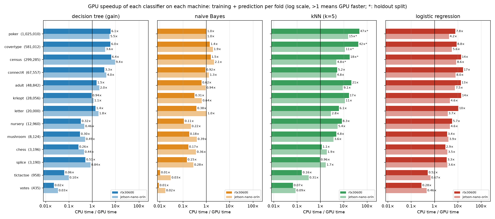
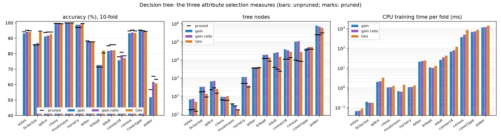
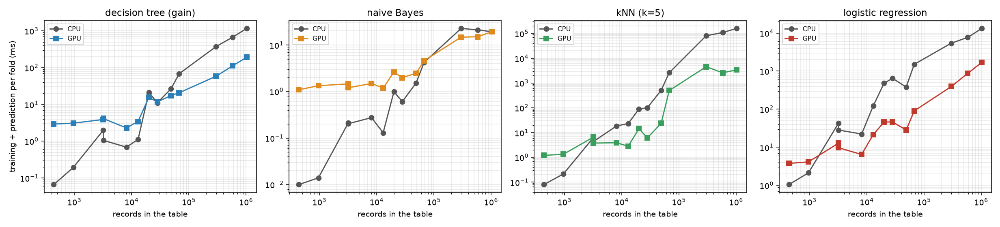
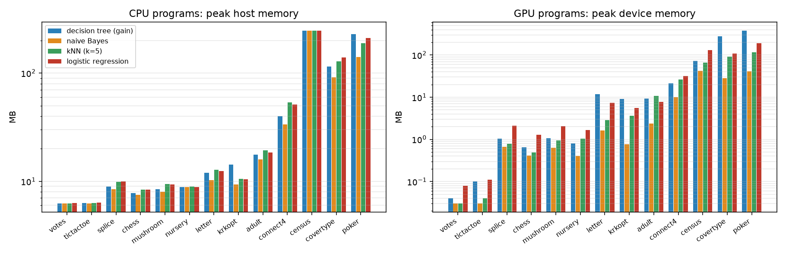
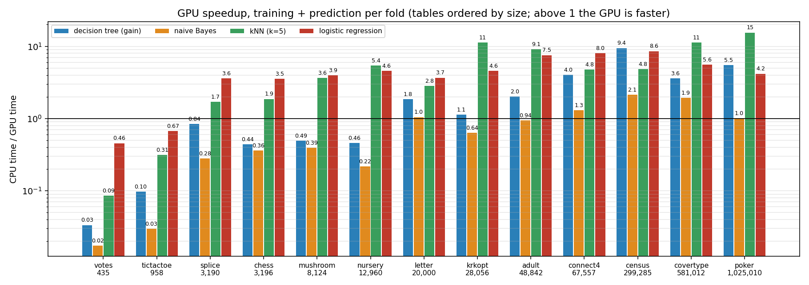
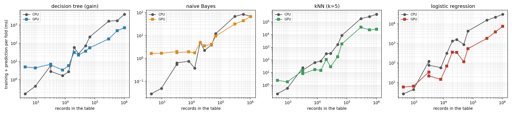
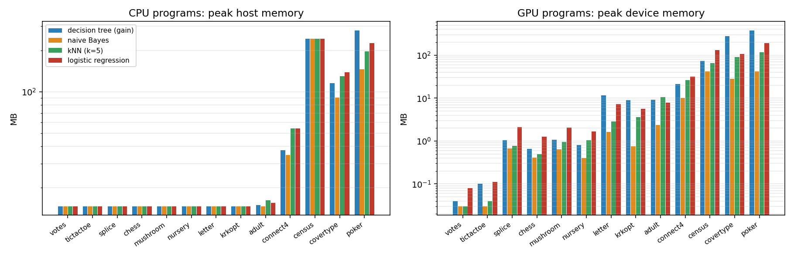
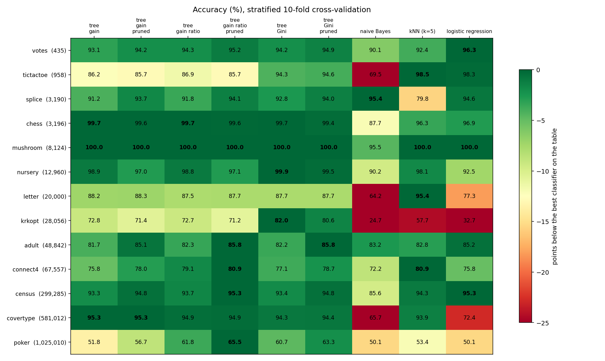
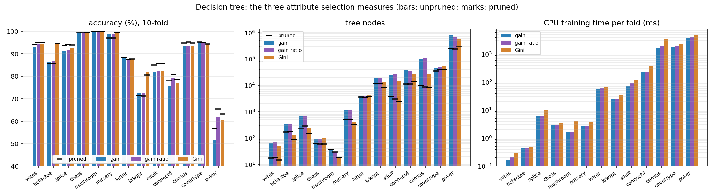

# Decision tree induction in C++ and CUDA

   

A decision tree classifier with three attribute selection measures (information gain,
gain ratio, Gini index), written from scratch in C++17, and three classifiers to compare it
with: naive Bayes, k-nearest neighbors, and logistic regression. Every classifier exists
twice, as a sequential CPU program and as a CUDA program. Course project for ESE 327
(Project 2), Stony Brook University.

| classifier | CPU | CUDA | what the GPU does |
|---|---|---|---|
| decision tree | `dtree_cpu` | `dtree_gpu` | grows a whole level of the tree at once: histograms, split scoring, and partitioning |
| naive Bayes | `nbayes_cpu` | `nbayes_gpu` | counting, per-class mean and variance, prediction |
| k-nearest neighbors | `knn_cpu` | `knn_gpu` | exhaustive distance search and voting |
| logistic regression | `logreg_cpu` | `logreg_gpu` | loss and gradient of every L-BFGS step |

No machine learning library is used by the programs. scikit-learn appears only in the test
scripts, as an outside reference.

**Highlights**

* **The same tree on every device.** The CPU and the GPU build identical trees, node for
  node, on all 13 tables and for all three measures, on a desktop RTX 3060 Ti and on a
  Jetson Orin Nano.
* **About 6× faster tree training on the large tables.** On the three largest tables the
  GPU tree is 6.0 to 6.4× faster than the CPU tree on the desktop (poker, 1 M records:
  1,166 ms to 191 ms per fold) and 3.6 to 9.4× faster on the Jetson.
* **Up to 47× for kNN and 17× for logistic regression** on the desktop, and 15× and 8.6×
  on the Jetson. Naive Bayes is one pass over the data on either device and about breaks
  even.
* **The tree is the most accurate classifier, or tied for it, on 9 of the 13 tables.**
  Which measure wins depends on the table: gain ratio reaches 61.8% on poker where
  information gain reaches 51.8%, and the Gini index reaches 82.0% on `krkopt` where the
  other two reach 72.8%.
* **2,306 correctness checks** against the textbook's worked examples, an independent
  pure-Python decision tree, and scikit-learn.
* **13 benchmark datasets** from the UCI Machine Learning Repository, from 435 to
  1,025,010 records, downloaded and converted by one script.



---

## Contents

* [Results](#results)
* [How it works](#how-it-works)
* [Correctness](#correctness)
* [Datasets](#datasets)
* [Building](#building)
* [Usage](#usage)
* [Reproducing the benchmarks](#reproducing-the-benchmarks)
* [Discussion](#discussion)
* [Limitations and future work](#limitations-and-future-work)
* [Repository layout](#repository-layout)
* [References](#references)

## Results

### Machines

| | Desktop | Embedded |
|---|---|---|
| CPU (runs the `_cpu` programs, single-threaded) | Intel Core i5-12400F, 32 GB RAM | Jetson Orin Nano, 6-core Arm Cortex-A78AE |
| GPU (runs the `_gpu` programs) | NVIDIA GeForce RTX 3060 Ti: 38 SMs, 8 GB GDDR6, compute capability 8.6 | Orin integrated Ampere GPU: 8 SMs, compute capability 8.7 |
| Memory | separate host RAM and GPU memory (PCIe) | 8 GB LPDDR5 shared by CPU and GPU |
| Software | Windows 11; g++ 14.2 `-O3`; CUDA 13.5 + MSVC | JetPack (Linux) |

Every run is a stratified 10-fold cross-validation with seed 327 and the same folds for
every classifier. Times are means per fold in milliseconds, excluding file reading; runs
under 20 seconds are repeated and the median is kept. Speedup = CPU time / GPU time.

### Decision tree on both machines

Training + prediction per fold, information gain, unpruned. Peak GPU memory is identical
on both machines.

| dataset | records | desktop CPU | desktop GPU | **speedup** | Jetson CPU | Jetson GPU | **speedup** | GPU mem (MB) |
|---|---:|---:|---:|---:|---:|---:|---:|---:|
| poker | 1,025,010 | 1,166 | 191 | **6.1×** | 3,978 | 720 | **5.5×** | 380 |
| covertype | 581,012 | 673 | 112 | **6.0×** | 1,770 | 494 | **3.6×** | 278 |
| census | 299,285 | 375 | 58.4 | **6.4×** | 1,661 | 176 | **9.4×** | 73 |
| connect4 | 67,557 | 68.3 | 20.7 | **3.3×** | 227 | 56.6 | **4.0×** | 21 |
| adult | 48,842 | 26.7 | 17.4 | **1.5×** | 73.9 | 36.9 | **2.0×** | 9 |
| krkopt | 28,056 | 11.1 | 11.7 | 0.94× | 25.6 | 22.7 | **1.1×** | 9 |
| letter | 20,000 | 21.3 | 15.5 | **1.4×** | 58.7 | 31.9 | **1.8×** | 12 |
| nursery | 12,960 | 1.12 | 3.45 | 0.32× | 2.72 | 5.95 | 0.46× | 1 |
| mushroom | 8,124 | 0.69 | 2.29 | 0.30× | 1.66 | 3.39 | 0.49× | 1 |
| chess | 3,196 | 1.06 | 4.13 | 0.26× | 2.84 | 6.44 | 0.44× | 1 |
| splice | 3,190 | 1.98 | 3.90 | 0.51× | 5.90 | 7.04 | 0.84× | 1 |
| tictactoe | 958 | 0.19 | 3.09 | 0.06× | 0.43 | 4.45 | 0.10× | 0 |
| votes | 435 | 0.07 | 2.92 | 0.02× | 0.17 | 4.99 | 0.03× | 0 |

### GPU speedup of every classifier

CPU time / GPU time for training + prediction per fold, on the desktop (D) and the
Jetson (J). `*`: exhaustive kNN on the CPU needs minutes per fold on the three largest
tables, so there both devices are timed on a single holdout split (10% of census and
covertype, 5% of poker).

| dataset | records | tree D | tree J | NB D | NB J | kNN D | kNN J | LR D | LR J |
|---|---:|---:|---:|---:|---:|---:|---:|---:|---:|
| poker | 1,025,010 | **6.1×** | **5.5×** | **1.0×** | **1.0×** | **47×**\* | **15×**\* | **7.8×** | **4.2×** |
| covertype | 581,012 | **6.0×** | **3.6×** | **1.4×** | **1.9×** | **42×**\* | **11×**\* | **8.8×** | **5.6×** |
| census | 299,285 | **6.4×** | **9.4×** | **1.5×** | **2.1×** | **18×**\* | **4.8×**\* | **14×** | **8.6×** |
| connect4 | 67,557 | **3.3×** | **4.0×** | 0.92× | **1.3×** | **5.2×** | **4.8×** | **17×** | **8.0×** |
| adult | 48,842 | **1.5×** | **2.0×** | 0.62× | 0.94× | **21×** | **9.1×** | **13×** | **7.5×** |
| krkopt | 28,056 | 0.94× | **1.1×** | 0.31× | 0.64× | **17×** | **11×** | **14×** | **4.6×** |
| letter | 20,000 | **1.4×** | **1.8×** | 0.38× | **1.0×** | **6.1×** | **2.8×** | **10×** | **3.7×** |
| nursery | 12,960 | 0.32× | 0.46× | 0.11× | 0.22× | **8.3×** | **5.4×** | **5.7×** | **4.6×** |
| mushroom | 8,124 | 0.30× | 0.49× | 0.18× | 0.39× | **4.8×** | **3.6×** | **3.4×** | **3.9×** |
| chess | 3,196 | 0.26× | 0.44× | 0.17× | 0.36× | **1.1×** | **1.9×** | **2.9×** | **3.5×** |
| splice | 3,190 | 0.51× | 0.84× | 0.15× | 0.28× | 0.96× | **1.7×** | **3.3×** | **3.6×** |
| tictactoe | 958 | 0.06× | 0.10× | 0.01× | 0.03× | 0.16× | 0.31× | 0.52× | 0.67× |
| votes | 435 | 0.02× | 0.03× | 0.01× | 0.02× | 0.07× | 0.09× | 0.28× | 0.46× |

### Time per fold

Training + prediction per fold in milliseconds on the tables of 20,000 records or more
(`*`: holdout split).

Desktop:

| dataset | records | tree CPU | tree GPU | NB CPU | NB GPU | kNN CPU | kNN GPU | LR CPU | LR GPU |
|---|---:|---:|---:|---:|---:|---:|---:|---:|---:|
| letter | 20,000 | 21.3 | 15.5 | 0.99 | 2.62 | 88.8 | 14.5 | 479 | 45.9 |
| adult | 48,842 | 26.7 | 17.4 | 1.53 | 2.47 | 507 | 23.8 | 383 | 28.4 |
| connect4 | 67,557 | 68.3 | 20.7 | 4.25 | 4.62 | 2,610 | 498 | 1,509 | 90.2 |
| census | 299,285 | 375 | 58.4 | 22.7 | 14.8 | 80,899* | 4,553* | 5,413 | 394 |
| covertype | 581,012 | 673 | 112 | 21.2 | 15.1 | 109,239* | 2,595* | 7,685 | 874 |
| poker | 1,025,010 | 1,166 | 191 | 19.3 | 19.2 | 159,720* | 3,408* | 13,213 | 1,700 |

Jetson:

| dataset | records | tree CPU | tree GPU | NB CPU | NB GPU | kNN CPU | kNN GPU | LR CPU | LR GPU |
|---|---:|---:|---:|---:|---:|---:|---:|---:|---:|
| letter | 20,000 | 58.7 | 31.9 | 5.08 | 4.85 | 305 | 108 | 1,309 | 356 |
| adult | 48,842 | 73.9 | 36.9 | 3.92 | 4.15 | 1,621 | 178 | 877 | 116 |
| connect4 | 67,557 | 227 | 56.6 | 12.2 | 9.43 | 8,721 | 1,832 | 4,266 | 532 |
| census | 299,285 | 1,661 | 176 | 68.1 | 32.0 | 185,296* | 38,320* | 15,378 | 1,797 |
| covertype | 581,012 | 1,770 | 494 | 84.6 | 44.0 | 264,344* | 23,442* | 21,622 | 3,860 |
| poker | 1,025,010 | 3,978 | 720 | 67.4 | 66.8 | 410,371* | 26,506* | 30,811 | 7,393 |

### Accuracy

Accuracy does not depend on the machine or the device, apart from the few records listed
under [Correctness](#correctness).


### The three selection measures

Accuracy in percent, unpruned and with C4.5 pessimistic pruning:

| dataset | gain | gain ratio | Gini | gain, pruned | gain ratio, pruned | Gini, pruned |
|---|---:|---:|---:|---:|---:|---:|
| tictactoe | 86.2 | 86.9 | 94.3 | 85.7 | 85.7 | 94.6 |
| nursery | 98.9 | 98.8 | 99.9 | 97.0 | 97.1 | 99.5 |
| krkopt | 72.8 | 72.7 | 82.0 | 71.4 | 71.2 | 80.6 |
| adult | 81.7 | 82.3 | 82.2 | 85.1 | 85.8 | 85.8 |
| connect4 | 75.8 | 79.1 | 77.1 | 78.0 | 80.9 | 78.7 |
| census | 93.3 | 93.7 | 93.4 | 94.8 | 95.3 | 94.8 |
| poker | 51.8 | 61.8 | 60.7 | 56.7 | 65.5 | 63.3 |



Every table and configuration, with separate training and prediction times, tree sizes,
peak host and device memory and logistic regression convergence, is in
[`results/rtx3060ti/summary.md`](results/rtx3060ti/summary.md) and
[`results/jetson-nano-orin/summary.md`](results/jetson-nano-orin/summary.md). The raw data
is in the `bench.csv` next to each summary.

### Per-machine plots

<details>
<summary><b>Desktop (RTX 3060 Ti)</b></summary>





</details>

<details>
<summary><b>Jetson Orin Nano</b></summary>







</details>

## How it works

### The decision tree

The tree is grown top-down as in Han & Kamber's `Generate_decision_tree`: a node becomes
a leaf when its records share one class or no attribute can split them; otherwise the
split with the best score is applied and each branch is grown the same way.

| measure | categorical attribute | numeric attribute | chosen split |
|---|---|---|---|
| information gain (ID3) | one branch per value | `A <= t` / `A > t` | highest gain |
| gain ratio (C4.5) | one branch per value | `A <= t` / `A > t` | highest gain ratio among splits with at least average gain |
| Gini index (CART) | `A in S` / `A not in S` | `A <= t` / `A > t` | largest reduction in impurity |

* **Numeric thresholds** are midpoints between adjacent distinct values. Up to 256
  distinct values per attribute the search is exact; beyond that, values are grouped into
  256 equal-frequency bins and thresholds are tried between bins (`--max-bins`).
* **Gini subsets.** All subsets are tried for up to 10 values. Above that, and always
  for two classes, values are ordered by the share of the node's majority class and only
  the splits of that order are tried, which is optimal for two classes.
* **Missing values** are an ordinary category for categorical attributes and sort after
  every real value for numeric ones. (Naive Bayes skips a missing numeric value; kNN and
  logistic regression replace it with the training mean.)
* **Pruning** (`--prune`) is C4.5's pessimistic subtree replacement with confidence 0.25.
* **Ties.** Scores closer than 1e-9 count as equal and the earlier candidate wins, which
  makes the tree unique and lets the CPU, the GPU and the Python reference be compared
  node for node.

### On the CPU (`dtree_cpu`)

Each node holds a range of an index array. For every attribute, one pass over the node's
records fills a histogram of (value, class) counts, and all candidate splits of the
attribute are scored from that histogram. The records are then partitioned in place and
the children recurse on their sub-ranges. A level of the tree costs time proportional to
records × attributes, and no data is copied.

### On the GPU (`dtree_gpu`)

The GPU builds the tree one level at a time, so that every kernel works on all open nodes
together.

| step | parallelism | what happens |
|---|---|---|
| 1. binning | device-wide sort per numeric column | distinct values are counted, which gives the bins; every cell is replaced by its bin number |
| 2. histogram | one thread per (record, attribute) | records are kept sorted by node; each thread adds 1 to its node's (attribute, value, class) counter |
| 3. score | one thread per (node, attribute) | scans that histogram and finds the attribute's best split, with the same formulas as the CPU in double precision |
| 4. choose and assign | one thread per node, then one per record | the winning attribute is picked; each record computes the child it moves to |
| 5. regroup | radix sort | child class counts are tallied, the host closes the nodes that became leaves, and the remaining records are regrouped by node for the next level |

A level with more nodes than fit in the histogram budget (`--hist-mb`, 256 MB by default)
is processed in several passes. Prediction is one thread per record walking the tree.

### Worked example

The 14-record `buys_computer` table of Han & Kamber (Table 8.1) gives the gains printed in
the book (0.246, 0.029, 0.151, 0.048) and the tree of its Figure 8.2:

```
$ dtree_cpu data/examples/buys_computer.csv --scores --print-tree --folds 0 --quiet
root scores (gain)
  age                          gain 0.246750  split_info 1.577406  gain_ratio 0.156428  multiway
  income                       gain 0.029223  split_info 1.556657  gain_ratio 0.018773  multiway
  student                      gain 0.151836  split_info 1.000000  gain_ratio 0.151836  multiway
  credit_rating                gain 0.048127  split_info 0.985228  gain_ratio 0.048849  multiway
[age] n=14 {no:5, yes:9}
  = youth: [student] n=5 {no:3, yes:2}
    = no: leaf no n=3 {no:3, yes:0}
    = yes: leaf yes n=2 {no:0, yes:2}
  = middle_aged: leaf yes n=4 {no:0, yes:4}
  = senior: [credit_rating] n=5 {no:2, yes:3}
    = fair: leaf yes n=3 {no:0, yes:3}
    = excellent: leaf no n=2 {no:2, yes:0}
```

With `--measure gini` the root becomes the binary split `age in {youth, senior}` with a
Gini index of 0.357, the value the book derives for that subset. With numeric attributes
(`play_tennis_numeric.csv`, gain ratio) the tree tests `humidity <= 77.5`, a midpoint
between two training values.

### The three other classifiers

**Naive Bayes.** Categorical attributes use value frequencies per class with Laplacian
correction; numeric attributes use a Gaussian per class. Prediction adds log
probabilities. On the GPU, categorical counts are integer atomic additions and the numeric
sums are accumulated in fixed blocks of 256 records, so the result does not depend on
thread timing. The book's Example 8.4 is reproduced with the correction switched off:

```
$ nbayes_cpu data/examples/buys_computer.csv --query youth,medium,yes,fair --alpha 0 --folds 0 --quiet
  no                     P(X|C) 0.0192  P(C) 0.357143  P(X|C)P(C) 0.00685714
  yes                    P(X|C) 0.0438957  P(C) 0.642857  P(X|C)P(C) 0.0282187
  predicted class: yes
```

**k-nearest neighbors** (k = 5). The distance is the sum of squared differences of numeric
attributes scaled to [0, 1], plus 1 for every categorical mismatch. The search is
exhaustive. Records tied with the k-th nearest all vote, so the answer does not depend on
record order. On the GPU the training set is cut into blocks of 512 records and one thread
handles one (test record, training block) pair; a second pass merges the per-block
candidates into the k-th distance and a third counts the votes.

**Logistic regression.** Multinomial (softmax) with L2 regularization, one-hot encoded
categorical attributes, standardized numeric attributes, trained by L-BFGS on the host for
at most 100 iterations. The GPU evaluates the loss and gradient: one thread per record for
the forward pass, and a column-oriented layout for the gradient so that each feature is
summed in a fixed order without atomics.

**Testing without a GPU.** `include/cuda_compat.h` wraps the CUDA runtime and CUB. When
it is compiled without `nvcc`, the kernels run serially, so each `.cu` file also builds
as a plain C++ program (`<name>_gpu_emu`) that the tests run next to the CPU and GPU
builds.

## Correctness

`python scripts/run_tests.py` runs four suites.

| suite | checks | what is compared |
|---|---:|---|
| `check_data.py` | 543 | loader, stratified folds and metrics against pandas and scikit-learn |
| `test_dtree.py` | 1,164 | root scores and trees against the textbook; trees and predictions against an independent pure-Python tree (`dtree_ref.py`) on random, edge-case and UCI tables, for all measures and options; scikit-learn as an outside check. Run for the CPU, GPU and emulation builds |
| `test_baselines.py` | 243 | naive Bayes against Example 8.4 and scikit-learn; kNN against a NumPy exhaustive search; logistic regression against scikit-learn's optimum |
| `test_gpu.py` | 356 | each GPU program against its CPU program |

**Result: 2,306 passed, 0 failed** on the desktop (CPU, GPU on the RTX 3060 Ti, and
emulation builds). In addition, the two benchmark sweeps were compared row by row (237
rows per machine):

* **Decision tree:** identical accuracy, macro-F1, node count and depth on the CPU and
  the GPU of both machines, for every table, measure and pruning setting. On the desktop
  the tree text and the predictions are also identical, including the three largest
  tables.
* **Naive Bayes:** identical results on both devices and both machines. With numeric
  attributes the GPU adds the sums in a different order, so statistics differ in the last
  bits; no benchmark accuracy changed.
* **kNN:** identical predictions on the desktop, and the Jetson's GPU program agrees
  with the desktop. The Jetson's CPU program classifies a few records differently on
  four tables with numeric attributes: 1 of 20,000 on letter, 5 of 28,056 on krkopt, 2 of
  48,842 on adult and 26 of 51,250 on the poker holdout. The likely cause is that g++ on
  Arm fuses the multiply and add of the distance sum, which the CUDA build forbids with
  `--fmad=false`; this has not been confirmed on the board.
* **Logistic regression:** the same objective value to the printed six digits;
  predictions agree on 99.7% of connect4 records at default settings, where the optimizer
  stops at the iteration limit. Between the two machines accuracy differs by at most 9
  records, on nursery, connect4 and census, all tables where the limit is reached.

## Datasets

All benchmarks come from the [UCI Machine Learning Repository](https://archive.ics.uci.edu/). `python scripts/fetch_uci.py` downloads them
into `data/raw/` and converts them into typed tables in `data/uci/`.

| dataset | UCI id | records | attributes | classes | conversion |
|---|---:|---:|---:|---:|---|
| votes | 105 | 435 | 16 | 2 | categorical |
| tictactoe | 101 | 958 | 9 | 2 | categorical |
| splice | 69 | 3,190 | 60 | 3 | the 60 DNA positions, categorical |
| chess (kr-vs-kp) | 22 | 3,196 | 36 | 2 | categorical |
| mushroom | 73 | 8,124 | 22 | 2 | categorical |
| nursery | 76 | 12,960 | 8 | 5 | categorical |
| letter | 59 | 20,000 | 16 | 26 | 16 numeric features |
| krkopt | 23 | 28,056 | 6 | 18 | board files categorical, ranks numeric |
| adult | 2 | 48,842 | 13 | 2 | train + test; 5 numeric attributes; `fnlwgt` dropped |
| connect4 | 26 | 67,557 | 42 | 3 | categorical; the `.Z` archive is decoded by the script |
| census (KDD) | 117 | 299,285 | 40 | 2 | train + test; instance weight dropped; coded columns categorical |
| covertype | 31 | 581,012 | 12 | 7 | 10 numeric attributes; wilderness area and soil type folded back into two categorical attributes |
| poker | 158 | 1,025,010 | 10 | 10 | train + test; per card, suit categorical and rank numeric |

A table is a CSV file whose header gives each column a name and a type: `num` (numeric),
`cat` (categorical), or `class` (the label, last column). A missing value is written `?`.

```
age:num,workclass:cat,education:cat,...,hours-per-week:num,native-country:cat,income:class
39,State-gov,Bachelors,...,40,United-States,<=50K
```

## Building

Requirements: a C++17 compiler; the CUDA Toolkit for the GPU programs; Python 3 with
numpy, pandas, scikit-learn and matplotlib for the scripts.

**Linux / Jetson** (Makefile):

```bash
make                # CPU programs, emulation builds, tools; GPU programs if nvcc is usable
make gpu            # only the CUDA programs
make gpu CUDA_ARCH=-arch=sm_87   # explicit architecture instead of native
```

**Windows.** Use `mingw32-make` with MSYS2 g++ for the CPU programs. `nvcc` needs the MSVC
compiler, so the CUDA programs are built with a batch file that finds Visual Studio itself,
or with CMake from a developer prompt:

```bat
scripts\build_gpu.bat                 :: all four, or name them: scripts\build_gpu.bat dtree knn
cmake -B build -G Ninja -DCMAKE_BUILD_TYPE=Release && cmake --build build
```

Two build settings matter:

* The kernels are compiled for the GPU in the machine (`-arch=native`). With a driver
  older than the toolkit, a binary built for the default architecture stops at startup with
  "the provided PTX was compiled with an unsupported toolchain".
* `--fmad=false` stops the compiler from fusing multiply and add, so the kernels round
  the same way as the CPU code. The identical trees depend on it.

## Usage

Every program takes a table and the same evaluation options:

```
dtree_cpu  <table.csv> [--measure gain|gain_ratio|gini] [--prune] [--prune-cf CF]
                       [--max-depth D] [--min-split N] [--max-bins B]
                       [--print-tree] [--scores]
nbayes_cpu <table.csv> [--alpha A] [--var-smoothing S] [--query v1,v2,...]
knn_cpu    <table.csv> [--k K]
logreg_cpu <table.csv> [--C X] [--max-iter N] [--tol T] [--dump-model file]

common:    [--folds K] [--holdout F] [--seed S] [--predictions file] [--json] [--quiet]
```

The `_gpu` programs take the same options; `dtree_gpu` adds `--hist-mb`. The default
evaluation is stratified 10-fold cross-validation with seed 327. The report gives
accuracy, macro-F1, mean training and prediction time per fold, peak host memory, and for
the GPU programs the peak device memory they allocated.

## Reproducing the benchmarks

```bash
python scripts/fetch_uci.py                              # tables into data/uci/
python scripts/run_tests.py                              # the four test suites
python scripts/benchmark.py --out results/<machine>      # about 30 minutes on the desktop
python scripts/benchmark.py --out results/<machine> --plot-only   # redraw from bench.csv
python scripts/compare_machines.py results/rtx3060ti results/jetson-nano-orin   # overview figure
```

`benchmark.py` accepts `--datasets`, `--configs` and `--devices` to run part of the sweep.
It writes `bench.csv`, `summary.md` and five figures.

## Discussion

* **The GPU pays off from about 20,000 records.** Below that, a few milliseconds of
  launch overhead per fold dominate, and the GPU tree and GPU naive Bayes are slower
  than their CPU programs; kNN and logistic regression already gain from a few thousand
  records. On the three largest tables the GPU tree trains about 6×
  faster on the desktop and builds exactly the same tree.
* **kNN gains the most, naive Bayes the least.** kNN has no training cost and pays at
  prediction, in proportion to training records × test records. It is the only
  classifier that is impractical on the CPU at this scale (160 s per fold on poker on
  the desktop), and the GPU cuts it by 42 to 47× on the two largest tables. Logistic
  regression makes up to 100 passes over the data and gains 8 to 17× from 20,000 records
  up. Naive Bayes is a single pass on either device.
* **The tree is cheap.** It trains in about a second on a million records on the desktop
  CPU. It is the second cheapest classifier after naive Bayes, and by far the cheapest
  to apply: prediction is a walk down at most a few dozen nodes.
* **The embedded GPU gives smaller but real gains.** On the Jetson the tree gains 3.6 to
  9.4× on the three largest tables, kNN up to 15× and logistic regression up to 8.6×.
  The Jetson's CPU programs take 2.1 to 5.1 times as long as the desktop's. Its GPU
  programs on the six largest tables take 1.9 to 4.4 times as long for the tree, but 3.7
  to 9.0 times for kNN and 4.1 to 7.5 times for logistic regression. So the kNN and
  logistic regression speedups fall the most on the Jetson, while the tree's stays close
  to the desktop's.
* **The Jetson's GPU beats the desktop's CPU on the large tables:** 1.2 to 2.1× faster
  for the tree on the four largest, and 6.0× faster for kNN on poker.
* **The Gini index wins on the all-categorical tables** tictactoe, nursery and krkopt,
  with smaller trees (tictactoe: 134 nodes against 335). The binary subset split keeps
  more records together per node than a branch per value does. This is an effect of the
  split shape as much as of the impurity formula. Gain ratio is the best or tied on the
  larger mixed tables (adult, connect4, census, poker), most visibly on poker. On the
  remaining tables the three measures are within two points of each other.
* **Gini is the most expensive measure** (census on the desktop CPU: 372, 490 and 834 ms
  for gain, gain ratio and Gini), because the subset search does more work per
  categorical attribute.
* **Pruning helps where there is noise.** It shrinks the tree by a factor of up to 10
  (census: 102,415 nodes to 9,718) and raises accuracy on the noisy tables (adult 81.7%
  to 85.1%), but costs accuracy on tables with no noise (nursery 98.9% to 97.0%).
* **Against the other classifiers.** Naive Bayes is the fastest and usually the least
  accurate. It wins on splice (95.4%), where the attributes are close to independent
  given the class, and fails where the class depends on combinations of attributes
  (krkopt 24.7%, tictactoe 69.5%). kNN is the best on letter (95.4%, numeric attributes
  with 26 classes) and tictactoe, and tied for the best on connect4. It is weakest on
  splice (79.8%), where 60 categorical attributes make most distances nearly equal.
  Logistic regression is the best on votes and tied on census, both close to linearly
  separable, and falls far behind the tree where the boundary is not linear (covertype
  72.4% against 95.3%, krkopt 32.7% against 82.0%).
* **No classifier does well on poker.** The pruned gain-ratio tree reaches 65.5%; the
  other three stay within a few points of the 50.1% majority class.
* **Memory.** Host memory of the CPU programs is dominated by the loaded table (census:
  247 MB for all four), so the classifiers differ little. On the device the tree uses the
  most on the large tables (covertype 278 MB, poker 380 MB): it holds the binned table,
  the sort buffers, and the level histogram, which is capped at 256 MB. Naive Bayes uses
  the least (42 MB at most). Device memory is the same on both machines. On the Jetson,
  where CPU and GPU share the same DRAM, the reported peak host memory of the largest GPU
  runs is higher than on the desktop (the tree on poker: 751 MB against 335 MB).

## Limitations and future work

* Logistic regression stops at the 100-iteration limit before reaching the gradient
  tolerance on krkopt, connect4 and covertype, and on some folds of nursery and census.
  Its accuracy there is for the default settings, not a fully converged model.
* The Jetson's CPU kNN differs from the other builds on a few records. Building the CPU
  programs with `-ffp-contract=off` should remove the difference, and would confirm the
  cause.
* GPU times include the copy of the fold's data to the device but not the one-time CUDA
  start-up of the process.
* On small tables the GPU programs are slower than the CPU programs. A size threshold
  below which a GPU program runs its CPU path would remove that cost.
* Exhaustive kNN on the CPU is timed on a single holdout split on the three largest
  tables.
* The numbers come from one run of the sweep on each machine. The Jetson's power mode and
  toolchain versions were not recorded with its results.

## Repository layout

```
include/dataset.h, eval.h, runner.h   table loader, stratified splits, metrics, run report
include/dtree.h                       tree, binning, pruning (shared by CPU and GPU)
include/dtree_app.h, nbayes.h,        options, model and main() of each classifier;
        knn_app.h, logreg.h           the CPU and GPU sources only supply a backend
include/encode.h, lbfgs.h             one-hot encoding and L-BFGS for logistic regression
include/cuda_compat.h                 CUDA / CUB wrappers, and serial emulation without CUDA
src/<name>_cpu.cpp                    sequential implementation
src/<name>_gpu.cu                     CUDA implementation
src/<name>_gpu_emu.cpp                the .cu file compiled as plain C++ (kernels run serially)
data/examples/                        textbook examples with their published trees
scripts/fetch_uci.py                  downloads and converts the 13 UCI tables
scripts/dtree_ref.py                  independent decision tree in pure Python
scripts/run_tests.py                  runs the four test suites
scripts/benchmark.py                  benchmark sweep: CSV, Markdown tables, figures
scripts/compare_machines.py           cross-machine speedup overview figure
results/overview.png                  speedup overview (both machines)
results/<machine>/                    bench.csv, summary.md and figures
Makefile, CMakeLists.txt              builds (Linux/Jetson; Windows with MSVC)
```

## References

* J. Han, M. Kamber, J. Pei, *Data Mining: Concepts and Techniques*, 3rd ed., chapters 8 and 9.
* J. R. Quinlan, *C4.5: Programs for Machine Learning*, 1993.
* L. Breiman, J. Friedman, R. Olshen, C. Stone, *Classification and Regression Trees*, 1984.
* UCI Machine Learning Repository, https://archive.ics.uci.edu
